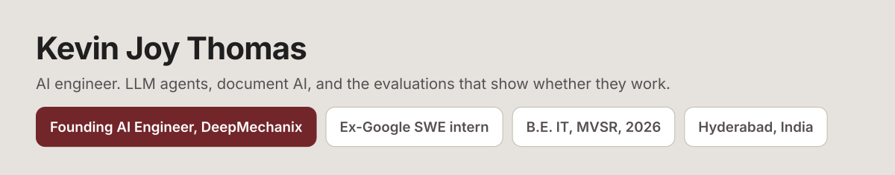
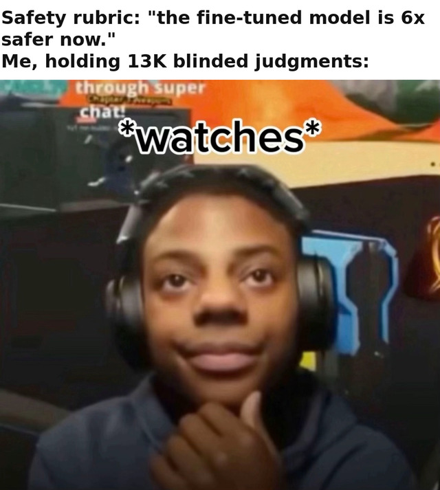
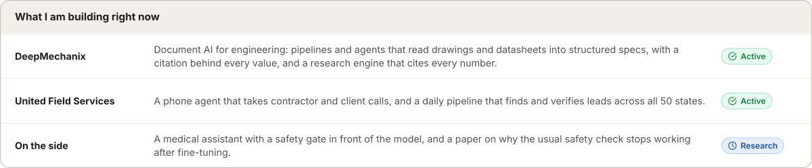
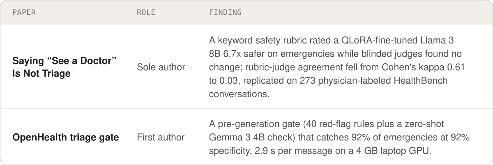
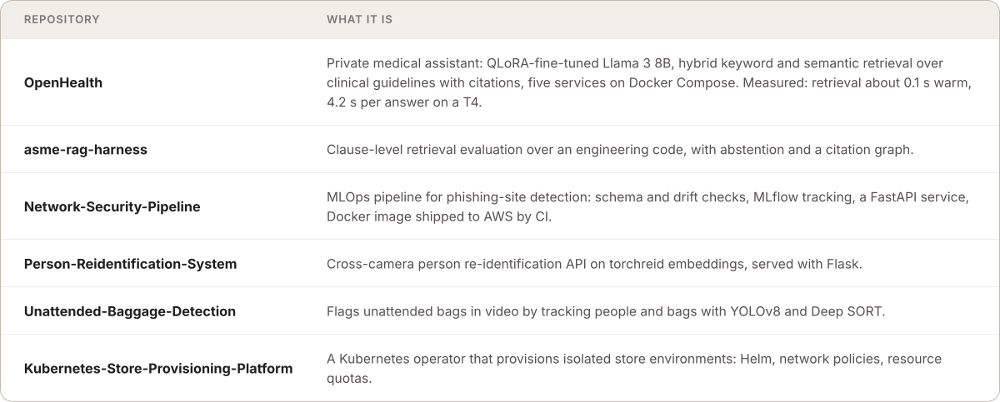
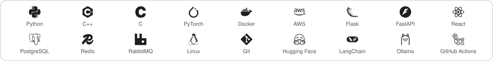

<picture>
  <source media="(prefers-color-scheme: dark)" srcset="assets/header-dark.svg">
  
</picture>

  
  
  
  

I build LLM systems that have to be right, not just fluent: extraction pipelines that read engineering documents into structured specs, agents that research with citations, a medical assistant with a safety gate in front of the model. I spend as much time on the evaluation as on the system, because that is how you find out it was wrong before a user does.

## Experience

<picture>
  <source media="(prefers-color-scheme: dark)" srcset="assets/experience-dark.svg">
  
</picture>

Text version

| Company | Role | Where | When |
|---|---|---|---|
| DeepMechanix | Founding AI Engineer | San Jose, remote | May 2026 to present |
| United Field Services | AI Engineer (AI Specialist), contract | Los Angeles, remote | Oct 2025 to present |
| Google | Software Engineering Intern, Workspace Search | Bangalore | Jun to Aug 2025 |
| Moksa.AI | Machine Learning Intern | Hyderabad | Feb to May 2025 |
| Envideo Technologies | Founding AI Engineer (Intern) | Remote | Feb 2024 to Mar 2025 |

Also taught data structures, algorithms and applied AI to engineering students at Suntek Corp Solutions, and ran technical sessions at WiseCoder (2025).

<picture>
  <source media="(prefers-color-scheme: dark)" srcset="assets/now-dark.svg">
  
</picture>

## Research

<picture>
  <source media="(prefers-color-scheme: dark)" srcset="assets/research-dark.svg">
  
</picture>

## Selected work

<picture>
  <source media="(prefers-color-scheme: dark)" srcset="assets/work-dark.svg">
  
</picture>

[OpenHealth](https://github.com/Kevinjoythomas/OpenHealth) · [asme-rag-harness](https://github.com/Kevinjoythomas/asme-rag-harness) · [Network-Security-Pipeline](https://github.com/Kevinjoythomas/Network-Security-Pipeline) · [Person-Reidentification-System](https://github.com/Kevinjoythomas/Person-Reidentification-System) · [Unattended-Baggage-Detection](https://github.com/Kevinjoythomas/Unattended-Baggage-Detection) · [Kubernetes-Store-Provisioning-Platform](https://github.com/Kevinjoythomas/Kubernetes-Store-Provisioning-Platform)

## Recognition

- 89th of 74,829 participants, Amazon ML Challenge 2024
- 8th place, HackXcelerate 2024, a national hackathon held with Microsoft, Hyderabad
- LeetCode: 759 problems solved, contest rating 1,758, top 10.4%

## Toolkit

<picture>
  <source media="(prefers-color-scheme: dark)" srcset="assets/toolkit-dark.svg">
  
</picture>

Also QLoRA, sentence-transformers, OpenVINO and YOLO.

B.E. in Information Technology, Maturi Venkata Subba Rao (MVSR) Engineering College, Hyderabad, 2022 to 2026.
