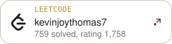
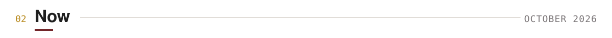

<picture>
  <source media="(prefers-color-scheme: dark)" srcset="assets/header-dark.svg">
  
</picture>

<a href="https://www.linkedin.com/in/kevin-joy-thomas/"><picture><source media="(prefers-color-scheme: dark)" srcset="assets/link-linkedin-dark.svg"></picture></a>
<a href="https://huggingface.co/kevinjoythomas"><picture><source media="(prefers-color-scheme: dark)" srcset="assets/link-huggingface-dark.svg"></picture></a>
<a href="https://leetcode.com/u/kevinjoythomas7/"><picture><source media="(prefers-color-scheme: dark)" srcset="assets/link-leetcode-dark.svg"></picture></a>
<a href="mailto:kevinjoythomas2004@gmail.com"><picture><source media="(prefers-color-scheme: dark)" srcset="assets/link-email-dark.svg"></picture></a>

I build LLM systems that have to be right, not just fluent: extraction pipelines that read engineering documents into structured specs, agents that research with citations, a medical assistant with a safety gate in front of the model. I spend as much time on the evaluation as on the system, because that is how you find out it was wrong before a user does.

<picture>
  <source media="(prefers-color-scheme: dark)" srcset="assets/heading-experience-dark.svg">
  
</picture>

<picture>
  <source media="(prefers-color-scheme: dark)" srcset="assets/experience-dark.svg">
  
</picture>

<picture>
  <source media="(prefers-color-scheme: dark)" srcset="assets/heading-now-dark.svg">
  
</picture>

<picture>
  <source media="(prefers-color-scheme: dark)" srcset="assets/now-dark.svg">
  
</picture>

<picture>
  <source media="(prefers-color-scheme: dark)" srcset="assets/heading-research-dark.svg">
  
</picture>

<picture>
  <source media="(prefers-color-scheme: dark)" srcset="assets/research-dark.svg">
  
</picture>

<picture>
  <source media="(prefers-color-scheme: dark)" srcset="assets/heading-selected-work-dark.svg">
  
</picture>

<a href="https://github.com/Kevinjoythomas/OpenHealth"><picture><source media="(prefers-color-scheme: dark)" srcset="assets/repo-openhealth-dark.svg"></picture></a>
<a href="https://github.com/Kevinjoythomas/asme-rag-harness"><picture><source media="(prefers-color-scheme: dark)" srcset="assets/repo-asme-rag-harness-dark.svg"></picture></a>
<a href="https://github.com/Kevinjoythomas/Network-Security-Pipeline"><picture><source media="(prefers-color-scheme: dark)" srcset="assets/repo-network-security-pipeline-dark.svg"></picture></a>

<a href="https://github.com/Kevinjoythomas/Person-Reidentification-System"><picture><source media="(prefers-color-scheme: dark)" srcset="assets/repo-person-reid-dark.svg"></picture></a>
<a href="https://github.com/Kevinjoythomas/Unattended-Baggage-Detection"><picture><source media="(prefers-color-scheme: dark)" srcset="assets/repo-unattended-baggage-dark.svg"></picture></a>
<a href="https://github.com/Kevinjoythomas/Kubernetes-Store-Provisioning-Platform"><picture><source media="(prefers-color-scheme: dark)" srcset="assets/repo-k8s-store-dark.svg"></picture></a>

<picture>
  <source media="(prefers-color-scheme: dark)" srcset="assets/heading-recognition-dark.svg">
  
</picture>

- 89th of 74,829 participants, Amazon ML Challenge 2024
- 8th place, HackXcelerate 2024, a national hackathon held with Microsoft, Hyderabad
- LeetCode: 759 problems solved, contest rating 1,758, top 10.4%

<picture>
  <source media="(prefers-color-scheme: dark)" srcset="assets/heading-toolkit-dark.svg">
  
</picture>

<picture>
  <source media="(prefers-color-scheme: dark)" srcset="assets/toolkit-dark.svg">
  
</picture>

B.E. in Information Technology, Maturi Venkata Subba Rao (MVSR) Engineering College, Hyderabad, 2022 to 2026.
