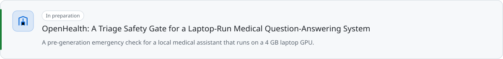
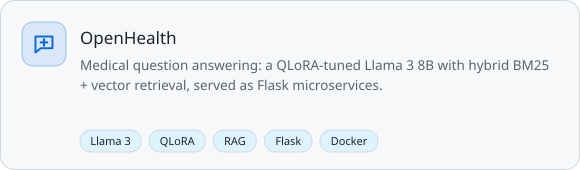
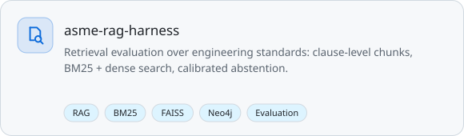
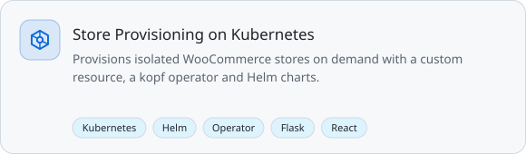
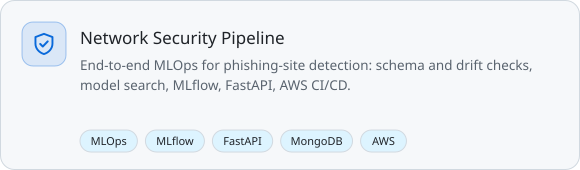
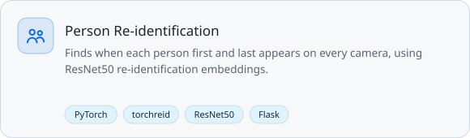
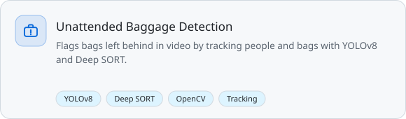
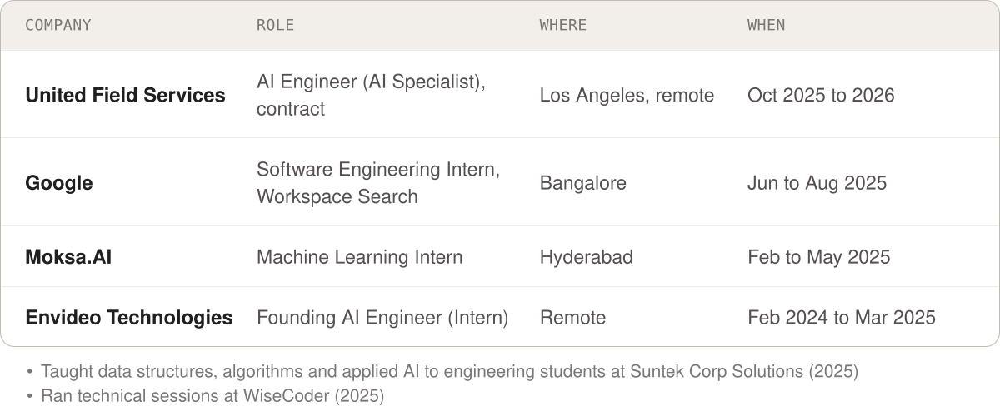

<picture>
  <source media="(prefers-color-scheme: dark)" srcset="assets/header-dark.svg">
  
</picture>

  
  
  
  
  

I build LLM systems that have to be right, not just fluent: medical question answering, retrieval over technical documents, and the evaluations that show whether either one actually works.

### Research

<a href="https://kevinjoythomas.github.io"><picture><source media="(prefers-color-scheme: dark)" srcset="assets/r-seedoctor-dark.svg"></picture></a>
<a href="https://github.com/Kevinjoythomas/OpenHealth"><picture><source media="(prefers-color-scheme: dark)" srcset="assets/r-openhealth-dark.svg"></picture></a>

### Selected work

<a href="https://github.com/Kevinjoythomas/OpenHealth"><picture><source media="(prefers-color-scheme: dark)" srcset="assets/p-openhealth-dark.svg"></picture></a>
<a href="https://github.com/Kevinjoythomas/asme-rag-harness"><picture><source media="(prefers-color-scheme: dark)" srcset="assets/p-asme-dark.svg"></picture></a>
<a href="https://github.com/Kevinjoythomas/Kubernetes-Store-Provisioning-Platform"><picture><source media="(prefers-color-scheme: dark)" srcset="assets/p-k8s-dark.svg"></picture></a>
<a href="https://github.com/Kevinjoythomas/Network-Security-Pipeline"><picture><source media="(prefers-color-scheme: dark)" srcset="assets/p-netsec-dark.svg"></picture></a>
<a href="https://github.com/Kevinjoythomas/Person-Reidentification-System"><picture><source media="(prefers-color-scheme: dark)" srcset="assets/p-reid-dark.svg"></picture></a>
<a href="https://github.com/Kevinjoythomas/Unattended-Baggage-Detection"><picture><source media="(prefers-color-scheme: dark)" srcset="assets/p-baggage-dark.svg"></picture></a>

<table>
<tr>
<td width="33%" align="center"> OpenHealth chat interface</td>
<td width="33%" align="center"> Unattended baggage flagged in video</td>
<td width="33%" align="center"> Stroke-risk app from an MLOps pipeline</td>
</tr>
</table>

### Experience

<picture>
  <source media="(prefers-color-scheme: dark)" srcset="assets/experience-dark.svg">
  
</picture>

### Recognition

<picture>
  <source media="(prefers-color-scheme: dark)" srcset="assets/recognition-dark.svg">
  
</picture>

### Toolkit

<picture>
  <source media="(prefers-color-scheme: dark)" srcset="https://skillicons.dev/icons?i=py%2Ccpp%2Cpytorch%2Ctensorflow%2Copencv%2Cdocker%2Ckubernetes%2Caws%2Cterraform%2Cflask%2Cfastapi%2Creact%2Cpostgres%2Cmongodb%2Clinux%2Cgit&theme=dark&perline=16">
  
</picture>

B.E. in Information Technology, Maturi Venkata Subba Rao (MVSR) Engineering College, Hyderabad, 2022 to 2026.
